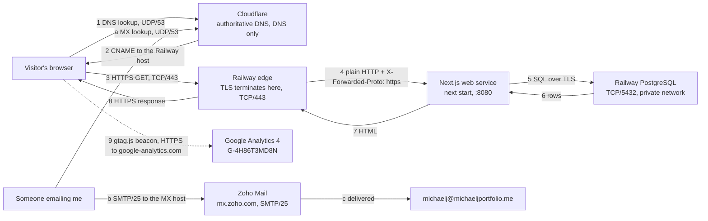
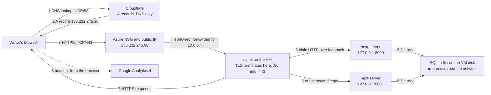

# Career Platform

A recruiter-facing résumé site for Michael Johnson, live at **https://michaeljportfolio.me**.
Next.js 15 (App Router, TypeScript) renders the page on each request from a PostgreSQL database,
hosted on Railway. The design system is recorded in [DESIGN.md](DESIGN.md) and product context in
[PRODUCT.md](PRODUCT.md).

**Project 1 submission index:** [docs/project-1-submission.md](docs/project-1-submission.md) — it
links every piece of evidence referenced below.

## How it runs today (Railway)

Locations, protocols, and ports, including the email and analytics paths.

Steps 1-8 are the page request. Step 9 is analytics: it leaves the **browser**, not the server, so
it does not depend on the host. Steps a-c are mail: the same zone answers the MX lookup, but mail
never touches the web service.

| Piece | Where | Notes |
|---|---|---|
| DNS | Cloudflare | `michaeljportfolio.me` CNAME → the Railway service domain, **DNS only**; `_railway-verify` TXT proves ownership. `www` is a proxied Cloudflare redirect (301) to the root domain, see below. |
| Web | Railway project `vivacious-happiness`, service `earnest-clarity`, environment `production` | Deploys every push to `main`. `railway.json` sets build, pre-deploy, start, and healthcheck. |
| Database | Railway PostgreSQL in the same project | The web service reads `DATABASE_URL = ${{Postgres.DATABASE_URL}}` over Railway's private network. |
| TLS | Railway | Railway issues and renews the certificate for the root domain; Cloudflare's Universal SSL covers `www`. |
| Email | Zoho Mail (free plan) | `michaelj@michaeljportfolio.me`. MX, SPF, DKIM, DMARC in the same Cloudflare zone. See [Domain email](#domain-email-zoho). |
| Analytics | Google Analytics 4 | Tag in `src/app/layout.tsx`. See [Analytics](#analytics-ga4). |
| Database-failure behaviour | `src/lib/content-service.ts`, `src/app/api/health/route.ts` | The page keeps the profile visible and replaces the project list with "Projects temporarily unavailable"; `/api/health` returns **503**. See [Database failure behaviour](#database-failure-behaviour). |

**Railway trial:** started 2026-10-08, ends about **2026-11-07** (30 days or $5 of usage). The Free plan
after it allows no custom domain, so the Azure VM is kept as the way back (see Rollback).

## Configuration guide

### Environment variables

| Variable | Where | Purpose |
|---|---|---|
| `DATABASE_URL` | Railway web service (reference to Postgres) | PostgreSQL connection. Unset locally → render from the snapshot. |
| `RAILWAY_DATABASE_URL` | Local `.env` only (git-ignored) | Postgres public URL for one-off laptop work. Append `?sslmode=no-verify` so the connection is encrypted. |

Secrets live in Railway variables and the git-ignored `.env`, never in the repo.

### Commands

| Command | What it does |
|---|---|
| `npm install` | Install dependencies (Node 22) |
| `npm run dev` | Local dev server; renders from the snapshot unless `DATABASE_URL` is set |
| `npm run build` | Generate the snapshot, then `next build` |
| `npm run start` | `next start` (Railway sets `PORT`; Next listens on `0.0.0.0`) |
| `npm test -- --run` / `npm run lint` / `npx tsc --noEmit` | Tests (integration tests run on PGlite, an in-process Postgres), lint, type-check |
| `npm run db:migrate` | Apply Drizzle migrations from `drizzle/` |
| `npx drizzle-kit generate --name <change>` | Create a migration after editing `src/db/schema.ts` |
| `npm run db:seed` | **Local development only.** Replace database content with `src/content/profile.ts` |
| `npm run db:move-rows -- <backup.sqlite> [--replace]` | One-time move of SQLite rows into PostgreSQL with their ids; compares every row afterwards (needs Node ≥ 22.13) |

### Updating the site

Push to `main`. Railway builds, runs `npm run db:migrate` as the **pre-deploy** step (the seed never
runs on deploy), health-checks `/`, and only then switches traffic. The deployment in Railway's
history carries the commit SHA. On Azure the same update was SSH, pull, build, and a service restart.

Content edits are database writes now: the live site shows what is in PostgreSQL, not what is in
`profile.ts` (for example, "SQL" was added to Analytics directly in the database on 2026-10-09).

### Railway and Cloudflare CLIs

`railway` (npm `@railway/cli`) is linked to project `vivacious-happiness` / service `earnest-clarity`:
`railway deployment list`, `railway logs --deployment <id>`, `railway domain list`,
`railway run --service Postgres -- node <script>` (passes `DATABASE_PUBLIC_URL` without printing it).
Avoid bare `railway domain`, which creates a domain. `cf` (npm `cf`, Cloudflare's CLI):
`cf dns records list --zone michaeljportfolio.me`.

Railway reports that `railway.json` ("config as code") is deprecated in favor of
`.railway/railway.ts`; existing files keep working until 2026-12-01. **To do:** run
`railway config migrate` before then.

### Behind Railway's proxy

Railway terminates TLS and forwards plain HTTP with `X-Forwarded-Proto`. Next.js trusts that header
by default (no Uvicorn-style `--proxy-headers` switch exists or is needed), so absolute URLs and
assets come out as `https://`. `src/middleware.ts` also 308-redirects `http://` to `https://` on the
public hosts (Railway's edge already 301s first) and never redirects Railway's healthcheck host or
`localhost`.

## Domain email (Zoho)

`michaelj@michaeljportfolio.me` runs on Zoho Mail's free plan. Cloudflare stays the DNS host; Zoho
supplies the mail records. Sending, receiving, and replying were all tested against an outside
mailbox on Microsoft 365, and the receiving side reported `spf=pass`, `dkim=pass`, `dmarc=pass`,
all three **aligned** to this domain.

| Name | Type | Value | Why |
|---|---|---|---|
| `@` | MX | `mx.zoho.com` (10), `mx2.zoho.com` (20), `mx3.zoho.com` (50) | Where other servers deliver mail for the domain |
| `@` | TXT | `v=spf1 mx include:zoho.com ~all` | Says which servers may send as this domain |
| `zmail._domainkey` | TXT | the DKIM public key | Lets a receiver verify Zoho's signature on each message |
| `_dmarc` | TXT | `v=DMARC1; p=none; rua=…` | Tells receivers what to do when SPF and DKIM disagree with the `From:` domain, and where to send reports |

The web records are untouched: the root `CNAME` is still **DNS only**, and the `CNAME` and `MX`
coexist at `@` because Cloudflare flattens the CNAME. Mail and web do not interact.

Evidence: [`docs/evidence/ex06.md`](docs/evidence/ex06.md) (tests, records, mail-tester 10/10) and
[`docs/evidence/zoho-header-check.md`](docs/evidence/zoho-header-check.md) (what the receiving server
decided, and why alignment is the point). The zone before any mail record existed:
[`docs/evidence/dns-before-zoho.md`](docs/evidence/dns-before-zoho.md).

## Analytics (GA4)

Google Analytics 4, measurement ID `G-4H86T3MD8N`, one web stream. The tag renders once in `<head>`
from `src/app/layout.tsx`, the only layout, so it loads on every route. The measurement ID is public
by design.

**How browser activity reaches Google.** The page loads `gtag.js` from Google's servers; that script
sends a request to `https://www.google-analytics.com/g/collect` carrying the event name and its
parameters. The beacon leaves the **visitor's browser**, never this server — which is why the data
survived the move from Azure to Railway untouched, and why a browser that blocks trackers is simply
never counted.

**Verified:** a `page_view`, and one useful interaction — an outbound `click` on the footer LinkedIn
link, captured in Tag Assistant with `link_url`, `link_domain`, and `outbound: true`. For a career
site that click is close to an outcome: it shows a reader followed the link off the site. It does
not show why, or what they did after arriving.

A privacy page (`src/app/privacy/page.tsx`), linked from the footer, states what GA4 collects, who
receives it, how to opt out, and what is **not** implemented (no cookie banner; Do Not Track and
Global Privacy Control are not honoured).

Evidence, screenshots, and the two things that went wrong:
[`docs/evidence/ex06.md` §3](docs/evidence/ex06.md).

## Who owns what

| Layer | On the Azure VM | On Railway |
|---|---|---|
| Operating system | Me — Ubuntu 24.04, patches, swap | Railway |
| Runtime | Me — Node 22 from NodeSource | Me — I pin the version; Railway builds the image |
| Public web entry point | Me — nginx, its config, its reloads | Railway's edge |
| TLS certificate | Me — Certbot, HTTP-01, the renewal timer | Railway (apex), Cloudflare (`www`) |
| Application code | Me | Me |
| Configuration and secrets | Me — `.env` on the VM | Me — Railway variables |
| Database software | Me — SQLite on disk | Railway runs PostgreSQL, but calls it **unmanaged** |
| Data, backups, restores | Me | **Me** — unmanaged means backups are mine |
| DNS | Me — Cloudflare | Me — Cloudflare |
| Process supervision | Me — systemd units | Railway |

**What I still own on Railway.** PaaS is not maintenance-free: the code, the runtime version, the
schema and its migrations, every secret, the data and its backups, DNS, testing, and recovery are
all still mine. Of the Azure tasks, the firewall rules, nginx `server_name`, Certbot, HTTP-01
validation, and the renewal timer moved to Railway — HTTPS here took one hostname and two DNS
records. The VM work of systemd units, swap, nginx, and SSH access rules disappears with it.

## How the migration kept the data

**What Git moved, and what did not.** Git carried the code, the schema, the migrations, the build
configuration, and `railway.json`. Git could not carry three things: the **secrets** (`.env` is
git-ignored; `DATABASE_URL` is a Railway variable referencing the Postgres service), the **runtime
and packages** (rebuilt on Railway from `package-lock.json`), and the **data**, which is not in the
repository at all. The data moved once, by script, from a verified backup.

**The real change that rules out seeding.** The VM's rows had drifted from `src/content/profile.ts`:
`resume_metadata.pdf_url` on the VM still held the old LinkedIn URL, while `profile.ts` had been
updated to the absolute PDF URL. That difference is what proves the transfer — the live page renders
the **relative** `/michael-johnson-resume.pdf`, which only the moved rows produce. Re-seeding from
`profile.ts` would have rendered the absolute URL instead, so seed data could not pass as a
transfer. A second, deliberate change was made after cutover: "SQL" was added to the Analytics
skills directly in Railway's PostgreSQL on 2026-10-09, and appeared on the live site with no
redeploy.

1. Backed up the VM's SQLite database with `sqlite3 .backup` (online, safe while the site read it),
   verified it read-only (`integrity_check` ok, row counts and full `.dump` identical to the live
   file), and copied it to the laptop with a matching SHA-256.
2. Switched the data layer to PostgreSQL with the same tables and columns; Railway's pre-deploy runs
   migrations only.
3. Moved every row with its original id in one transaction (`npm run db:move-rows`), then compared
   the live VM database with Railway table by table: 13 tables, 55 rows, 268 cells, 0 differences.

Details, commands, and results: [the migration plan](docs/superpowers/plans/2026-10-08-railway-postgres-migration.md).

## Deviations from the class guide

- **`www` is a Cloudflare redirect, not a second Railway domain.** Railway allows one custom domain
  on this plan, so `www` is an A record to a placeholder (`192.0.2.1`), **proxied**, with a
  Cloudflare Redirect Rule (301 to `https://michaeljportfolio.me`, path and query kept). The root
  record stays DNS only, so the HTTPS path documented for Ex04 is unchanged.
- **Local development no longer uses SQLite.** The guide keeps local development on SQLite. We
  removed SQLite support by mistake when the data layer moved to PostgreSQL. Adding it back would
  mean two schemas, two migration sets, and two versions of the seed code, with every future schema
  change made twice, which is far too costly for my limited credits. Locally the site renders from
  the snapshot with no database, tests run on PGlite, and `docker-compose.yml` provides Postgres
  when a real local database is needed.
- **The VM was not on `main` when the migration started** (it ran `28bd532`). It was updated
  afterwards to `3ec9e9c`, the last SQLite version with the current design, so a rollback shows
  the same site.

## Rollback

Reverting **code** is a push: revert the commit on `main` and Railway redeploys. The deployment
history in Railway carries the commit SHA, so the version to go back to is the previous `SUCCESS`
deployment's SHA.

Reverting **data** is not a push. Railway takes writes (the "SQL" skill exists only there), so any
move away from it has to carry those rows.

**The Azure fallback is gone.** The VM was deleted on 2026-10-22, so steps 3 and 4 below no longer
describe a server that exists. Going back to Azure now means rebuilding it from
[the Azure migration plan](docs/superpowers/plans/2026-09-24-azure-vm-migration.md) and
[operating the VM](docs/superpowers/plans/2026-10-01-operate-the-vm.md) — both record every command,
unit file, and nginx block — then restoring
`data/backups/career-platform-20261008T2154Z.sqlite` and following the steps below. Budget hours,
not minutes. The surviving VNET, public IP, and NSG in `rg-career-platform` would be reused.

The procedure, for whichever target the VM is rebuilt as:

1. Pause content changes and compare both databases (the comparison in the plan is the template).
2. Copy any Railway-only rows into the SQLite database.
3. In Cloudflare, replace the root CNAME with an A record to the VM's address (DNS only) and point
   `www` back the same way.
4. Issue a fresh certificate once DNS points back:
   `sudo certbot --nginx -d michaeljportfolio.me -d www.michaeljportfolio.me`. The VM's old
   certificate (valid to 2027-01-06) went with the VM.

A **schema** change needs the same care as data: Drizzle migrations only move forward, so rolling
back a migration means writing the reverse migration and applying it with `npm run db:migrate`
before redeploying the older code.

The VM (`vm-career-platform`, `rg-career-platform`) stays running until the instructor says it can
stop. Backup: `~/backups/career-platform-20261008T2154Z.sqlite` on the VM and
`data/backups/` (git-ignored) on the laptop.

## Decisions

### 1. Move from an Azure VM to Railway

**Alternatives considered:** stay on the VM and keep hardening it; move to another PaaS; containerise
and run on a managed container service. **Chosen:** Railway, because the operational load was the
dominant cost at this size.

- **Cost:** the Azure VM ran on student credits around the clock; Railway's trial is $5 or 30 days,
  then a paid plan is needed to keep the custom domain. Compare the monthly bill against the hours below.
- **Our hours:** the VM needed a firewall, swap, systemd units, nginx, Certbot, renewal checks, and
  SSH access rules that broke whenever a laptop changed networks; Railway needed a CNAME and a TXT
  record, and an update is a push.
- **Control:** on the VM we chose every version and setting; on Railway the platform picks the
  build image and edge, and config moved into `railway.json` (already marked deprecated).
- **Reliability:** Railway health-checks each release before switching traffic and swapped
  containers with no visible downtime; the VM ran two app copies behind nginx, but a VM restart or
  auto-shutdown took the site down.
- **What would change the answer:** steady high traffic where a VM is cheaper per request,
  compliance needs that require owning the host, or a database that needs managed backups (Railway's
  PostgreSQL is unmanaged).

**Recommendation for a three-developer startup currently on an Azure VM:** move. At three people the
hours spent on nginx, Certbot, and systemd are the expensive resource, not the server. Revisit if
traffic becomes steady and high, if compliance requires owning the host, or once the database needs
managed backups.

### 2. Managed email (Zoho) rather than self-hosted mail

**Alternatives considered:** run a mail server on the Azure VM (Postfix and Dovecot); use a
send-only API such as Resend or SES with no mailbox; use Zoho's free hosted mailbox.
**Chosen:** Zoho.

- **Deliverability is the whole product.** A new VM address has no sending reputation, and cloud
  providers commonly block outbound port 25 by default, so self-hosted mail would likely not have
  been delivered at all. Zoho's relays are already trusted: the test message scored 10/10 at
  mail-tester and Microsoft gave it `SCL:-1`, its lowest spam confidence.
- **A send-only API has no inbox.** The requirement is an address a recruiter can reply to, so
  send-only was out.
- **The security work is real and never finishes.** Self-hosting means owning SPF, DKIM key
  rotation, DMARC, TLS for SMTP and IMAP, spam filtering, and blocklist monitoring, forever, for one
  mailbox.
- **Cost:** Zoho's free plan covers one domain mailbox, so self-hosting would have saved nothing.
- **What I gave up:** Zoho holds my mail, I depend on their uptime and their relays' reputation, and
  the DKIM private key is theirs rather than mine.

### 3. SQLite as the initial engine, PostgreSQL on Railway

**Alternatives considered:** PostgreSQL on the VM from the start; a managed database from day one;
flat JSON files in the repository. **Chosen:** SQLite first.

- **It is a file, not a service.** On a 1 GiB VM that meant no second process competing for memory,
  no port to firewall, no database user or password to manage, and nothing extra to start at boot.
  The Azure milestone was about nginx, systemd, and TLS; adding database administration on top would
  have doubled what could break without teaching anything the exercise asked for.
- **The workload suits it exactly.** One profile, a handful of projects, read on every request,
  written by me a few times a week. There is one writer and no concurrency to speak of, which is
  where SQLite's single-writer limit would otherwise bite.
- **Flat files were the real alternative, and lost.** JSON in the repository would have made every
  content edit a commit and a redeploy, and would have proved nothing about reading from a database
  at request time.
- **Why it could not stay.** Railway's filesystem is ephemeral: a file-based database is wiped on
  every redeploy, so the writes would vanish. Railway also offers PostgreSQL as a managed service on
  the same private network. The migration to PostgreSQL was forced by the platform, not by SQLite
  failing at its job — it did the Azure job well, and the move is recorded in full in
  [the migration plan](docs/superpowers/plans/2026-10-08-railway-postgres-migration.md).

## Two investigated failures

### A. Application and database dependency: the build passed but PostgreSQL had no tables

- **Symptom.** The first Railway deploy succeeded and the site answered `200`, but the page was
  rendering from the build-time snapshot, and Railway's PostgreSQL still had **zero** tables ten
  minutes after the build.
- **Checks.** Connected to Postgres read-only over the public proxy and confirmed the session was
  encrypted (`select ssl from pg_stat_ssl where pid = pg_backend_pid()` → `true`), then listed
  `public` tables → none. Re-read the deploy log for the pre-deploy step → it had never run. Checked
  the service's **Settings → Config file** → it was not pointed at `railway.json`.
- **Diagnosis.** The web service was not reading `railway.json`, so the pre-deploy
  `npm run db:migrate` never executed. The snapshot fallback then hid the empty database behind a
  normal `200`, which is why the symptom looked like success. That masking is the reason the project
  requires a 503 instead, and the behaviour has since been changed (see
  [Database failure behaviour](#database-failure-behaviour)).
- **Repair.** Pointed Settings → Config file at `railway.json` (2026-10-08, about 22:29 UTC), and ran
  `npm run db:migrate` once from the laptop over TLS to unblock the row move.
- **Repeated verification.** PostgreSQL's `pg_stat_user_tables` shows
  `drizzle.__drizzle_migrations` with `seq_scan = 3` since the server started at 21:31:59 with no
  stats reset — the one manual run plus the two deploys after the change — and `n_tup_ins = 1`, so
  later runs applied nothing new. A full runtime log review (Oct 8 21:28 – Oct 9 18:23 UTC) found
  **zero** `content_service_fallback` and **zero** `pg_pool_error` lines: the live site was reading
  PostgreSQL, not the snapshot.

### B. Network and DNS: `www` still resolved to the retired VM after the cutover

- **Symptom.** After the apex moved to Railway, `https://michaeljportfolio.me` served the new
  release while `https://www.michaeljportfolio.me` still served the **old design**.
- **Checks.** `nslookup` against `1.1.1.1`: the apex returned Railway's address, but `www` still
  returned `135.232.245.90`, the Azure VM. Both certificates were valid, so this was a name problem,
  not a TLS problem. Adding `www` as a second custom domain in Railway then failed: the plan allows
  one.
- **Diagnosis.** Only the apex record had been repointed. The VM was still running and still held a
  certificate covering both names, so `www` kept serving happily from the old deployment instead of
  failing visibly — the worst kind of DNS fault, because nothing looks broken.
- **Repair.** Replaced the `www` A record with a **proxied** A record to `192.0.2.1` (a reserved
  documentation address that is never connected to) and added a Cloudflare Redirect Rule: 301 to
  `https://michaeljportfolio.me`, path and query preserved. Cloudflare answers the redirect at its
  own edge, so the placeholder address is never contacted.
- **Repeated verification (2026-10-09, from outside the campus network).** `http://www…/` and
  `https://www…/` both return **301** to `https://michaeljportfolio.me/` with `server: cloudflare`;
  `https://www…/michael-johnson-resume.pdf?x=1` redirects with path and query intact and ends at
  `200` after one hop; the `www` certificate is Cloudflare Universal SSL (Let's Encrypt, SAN
  `*.michaeljportfolio.me`, valid to 2026-12-30). The apex certificate is unchanged.

A third, **deliberate lab failure** — a stale A record causing a TLS name mismatch — is worked
through in [`docs/evidence/ex05.md`](docs/evidence/ex05.md). It is the supplied Exercise 05
simulation, labelled as such: the outputs came from the handout and were interpreted, not run.
The Azure-era application and database failure (the app and the scripts reading two different
database paths, fixed in `cf8324b`) is in [`docs/evidence/ex03.md`](docs/evidence/ex03.md).

## Database failure behaviour

A healthy request renders the profile **and the projects** from PostgreSQL, and `/api/health`
returns **200**.

When the database cannot answer, three things happen:

1. The profile still renders, from `src/generated/profile-snapshot.json` — authored content, clearly
   the same text as `src/content/profile.ts`, not invented data.
2. The project list is **empty and labelled**: "Projects temporarily unavailable". The service strips
   the project array (`src/lib/content-service.ts`), so there is nothing for the page to substitute.
   A fallback that keeps the site looking healthy also keeps a real outage invisible — exactly what
   happened in failure A above, which is why the snapshot no longer stands in for a failed query.
3. **`/api/health` returns HTTP 503** with `{"status":"projects_unavailable"}`. It runs the same
   query the page runs, so a 200 there means the page can render its projects.

An **empty** project table is treated as a deliberate state rather than a failure: the page says
"No projects are published yet" and the request stays healthy.

Recovery needs no restart. The page is `dynamic = "force-dynamic"` and the pool reconnects on the
next query, so the first refresh after the database returns renders the projects again.

**Known gap: the HTML document still returns 200 during an outage**, not 503. A Next.js App Router
page cannot set its own status code — only a Route Handler or middleware can — so the 503 lives at
`/api/health`. Moving it onto the document response needs Node-runtime middleware, which was not
worth the risk of taking the site down to add. Recorded here rather than glossed over.

What was observed, and what was not:
[`docs/evidence/db-outage-test.md`](docs/evidence/db-outage-test.md).

## Costs, credits, and cleanup

| Service | What it costs | Expires | Cleanup plan |
|---|---|---|---|
| Azure VM `vm-career-platform` (`Standard_B2ats_v2`) | Azure for Students credit | — | **Deleted 2026-10-22.** No longer billing. |
| Azure VNET, public IP (Standard, static), and NSG in `rg-career-platform` | Billed from the same credit; a static public IP bills even with no VM attached | — | **Still present.** Deleting `rg-career-platform` removes all three. Do that once the instructor confirms the VM is no longer needed, since the IP accrues cost while it is reserved. |
| Railway (web service and PostgreSQL) | Trial: $5 of usage or 30 days | Started 2026-10-08, ends about **2026-11-07** | Before it ends, either start a paid plan (the Free plan allows no custom domain) or roll back to Azure using [Rollback](#rollback). |
| Railway Postgres TCP proxy | Included | — | **Open:** remove it now that the laptop database work is finished. |
| Cloudflare DNS | Free plan | — | Keep: it holds both the web and the mail records. |
| `michaeljportfolio.me` at Namecheap | Annual registration | The renewal date is in the Namecheap account and is **not recorded here** | Keep, or let it lapse after the course. |
| Zoho Mail | Free plan, one domain mailbox | — | Keep. Removing it means deleting the MX, SPF, DKIM, and DMARC records too. |
| Google Analytics 4 | Free | — | Keep, or delete the property and remove the tag from `src/app/layout.tsx`. |

## Third-party security incident (October 2026)

On 2026-10-21 Railway disclosed that an unauthorised party had reached the systems storing customer
environment variables, and that encrypted variables may have been decrypted and read. Database
credentials were explicitly in scope. Railway paused deployments platform-wide, rotated its own
storage credentials, and invalidated every API and project token created before the incident.

**What this project had exposed.** One secret: the PostgreSQL password, held as `DATABASE_URL` on
the web service and as `POSTGRES_PASSWORD` on the database service. Nothing else. Mail
authentication lives at Zoho, the GA4 measurement ID is public by design, and no credential has ever
been committed to this repository — `.env` and `data/` are in `.gitignore`.

**What limited the damage.** The database has no public endpoint. `DATABASE_URL` resolves to
`postgres.railway.internal:5432`, and the database service has no `DATABASE_PUBLIC_URL` and no TCP
proxy variable, the temporary proxy used for the migration having been removed once that work
finished. A leaked password is therefore only usable from inside this project's private network, not
from the internet.

**Response.** The rotation is performed with Railway's Regenerate control, which changes the
password inside PostgreSQL and updates the variables that reference it in one step. It is a
dashboard action: the public GraphQL API exposes no equivalent mutation, and `railway ssh` requires
registering an SSH key against the account. Editing
`POSTGRES_PASSWORD` by hand does **not** work: the variable is read only when the database is first
created, so hand-editing it leaves the stored role password unchanged and desynchronised from the
variable, and every new connection then fails to authenticate. Because containers read variables
only at startup, the web service is redeployed afterwards so it picks up the new value.
**Done on 2026-10-26.** The password was regenerated, the database restarted, and Railway created a
new deployment of the web service when its referenced `DATABASE_URL` changed. The gap between those
two restarts left the application holding a credential the database no longer accepted for about a
minute, which produced the degraded behaviour on the live site and is recorded in
[`docs/evidence/db-outage-test.md`](docs/evidence/db-outage-test.md#the-degraded-half-observed-in-production-2026-10-26).
`/api/health` answered `200` with `"source":"database"` afterwards, on the same commit as before.

**What this cost.** Four days of deployment delay, only part of it Railway's. Builds returned for
Free and Trial workspaces at 23:22 UTC on 2026-10-22, a few hours after the change was merged. It
still did not deploy until 2026-10-26, because restoring builds does not retroactively build the
commits pushed while deploys were paused, and no new push had been made in the meantime to trigger
one. The lesson is that a queued deploy is not a pending deploy: after a provider pause, the build
has to be asked for again.

## Limitations

Known gaps, stated rather than hidden:

- **Only a credential failure has been seen in production, not an unreachable database.** Both
  halves of the behaviour are now verified live — the credential rotation of 2026-10-26 produced a
  genuine failed query, and `/api/health` answered 503 with the projects list labelled unavailable
  while the rest of the page rendered. What that did not exercise is a database that cannot be
  reached at all, for example a network outage or a stopped service. That case is covered by the
  unit tests. Evidence:
  [`docs/evidence/db-outage-test.md`](docs/evidence/db-outage-test.md#the-degraded-half-observed-in-production-2026-10-26).
- **The outage status code is on `/api/health`, not on the page.** During a database outage the
  HTML document answers `200` while `/api/health` answers `503`. The project asks for the page
  itself to return 503; an App Router page has no API for setting a status. See
  [Database failure behaviour](#database-failure-behaviour).
- **The production database is not reachable from my laptop**, so the healthy half of the outage
  test was verified against the live site and the outage half locally. The Railway web service
  reaches PostgreSQL over the project's private network, which is unaffected.
- **The Azure VM has been deleted, so the rollback target no longer exists.** The VM was deallocated
  and deleted on 2026-10-22; `az vm show` returns `ResourceNotFound`. The project says the VM stays
  running "until the instructor says otherwise", and **the instructor told the class the VM could be
  deleted**, so this is a released requirement rather than a deviation. The practical consequence
  stands either way and is in [Rollback](#rollback): going back to Azure now means rebuilding the VM
  from the records, not repointing DNS at a running server. The resource group
  `rg-career-platform` still holds the VNET, the public IP, and the network security group — which
  is how the port 443 rule was recovered for the record above.
- **No pre-MX delivery test was captured.** The project asks for a message sent to the custom address
  *before* any mail record existed, with the outcome recorded. That test was not run, and MX is now
  published, so it cannot be reconstructed. Marked **unverified** rather than invented.
- **The phone-network timeout was never fully explained.** A packet capture on the VM showed two
  connection attempts from the carrier and no request after them, while another site loaded on the
  same phone, so the fault lay between the carrier and the VM. It stopped mattering after the move to
  Railway, so the investigation was closed unresolved.
- **The live site has only been checked from home networks and from the VM.** LMU's filter shows
  "Web Page Blocked" for new domains on campus Wi-Fi, which is the filter, not the site.
- **Local development runs without SQLite**, against the snapshot or a Docker PostgreSQL, which is a
  deliberate deviation from the class guide (see Deviations).

## Retrospective

*Written after the work, not during it.*

- **What went well:** verifying instead of assuming. The backup was checked byte for byte, the move
  was rehearsed on the real data in PGlite before touching production, and the final comparison read
  both databases independently of the migration code.
- **What I'd do differently:** confirm the deploy configuration (config file, pre-deploy, healthcheck)
  before the first Railway deploy, keep the project outside OneDrive, and check the class guide's
  constraints (SQLite locally, `www` left alone) before planning, not after.
- **What surprised me:** HTTPS went from a day of nginx and Certbot to two DNS records, but the
  responsibility didn't vanish: backups, DNS, and the trial clock are still mine. The sharpest lesson
  came from failure A — a fallback that keeps the site up will also keep a real outage invisible,
  which is why the requirement asks for a 503, and why the fallback is gone.

## FAQ: real failures and their fixes

1. **Why did `next build` fail with `EINVAL: invalid argument, readlink …\.next\…`?** The repo lives
   in OneDrive, which breaks the symlinks Next writes in `.next`. Delete `.next` and rebuild. Windows
   may then offer to delete ~1,400 files from OneDrive; those are build output and safe to remove.
2. **Why did Railway refuse to deploy?** It blocks projects with vulnerable packages. `next@15.3.5`
   had critical CVEs; upgrading to 15.5.27 (plus `drizzle-orm` 0.45.4 and `postcss`/`sharp`
   overrides) took `npm audit --omit=dev` to 0.
3. **The build passed, so why were there no tables in PostgreSQL?** See failure A above.
4. **Why did the site time out on my phone?** See Limitations — unresolved, and overtaken by the move
   to Railway. Separately, on campus LMU's filter shows "Web Page Blocked" for new domains; test from
   home or a hotspot.
5. **Why does SSH to the VM hang?** The Azure rule allows only one laptop IP, and the laptop's IP
   changes between campus and home. Update `Allow-SSH-Laptop` to the current IP. A hang after 18:00
   meant auto-shutdown had deallocated the VM (now turned off).
6. **Why can't I add `www` as a second custom domain?** Railway's plan allows one. `www` is a
   Cloudflare redirect instead — see failure B above.
7. **Why did `railway run -- node -e '<script>'` print nothing?** On Windows, `railway.exe` passed
   only the first line of the multi-line script. Put the script in a file and run `node <file>`.

## History: Azure VM (Sept–Oct 2026)

The site first ran on an Azure VM (`vm-career-platform`, Ubuntu 24.04): two Next.js copies under
systemd behind nginx, SQLite on disk, Let's Encrypt via Certbot.

The app never listened on a public address: only ports 22 and 80/443 were reachable from the
internet, and the two app copies answered on loopback only. Mail did not exist yet — Zoho came after
the move to Railway — and the analytics beacon, then as now, would leave the browser rather than the
server.

Records: [migration to Azure](docs/superpowers/plans/2026-09-24-azure-vm-migration.md),
[operating the VM](docs/superpowers/plans/2026-10-01-operate-the-vm.md),
[how the VM site was secured (Ex04)](docs/how-this-site-is-secured.md),
[Exercise 03 evidence](docs/evidence/ex03.md).
A step-by-step walkthrough of how a request travelled on the VM, with the Railway path beside it, is
in [practice.md](practice.md).
