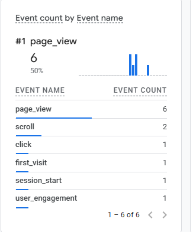
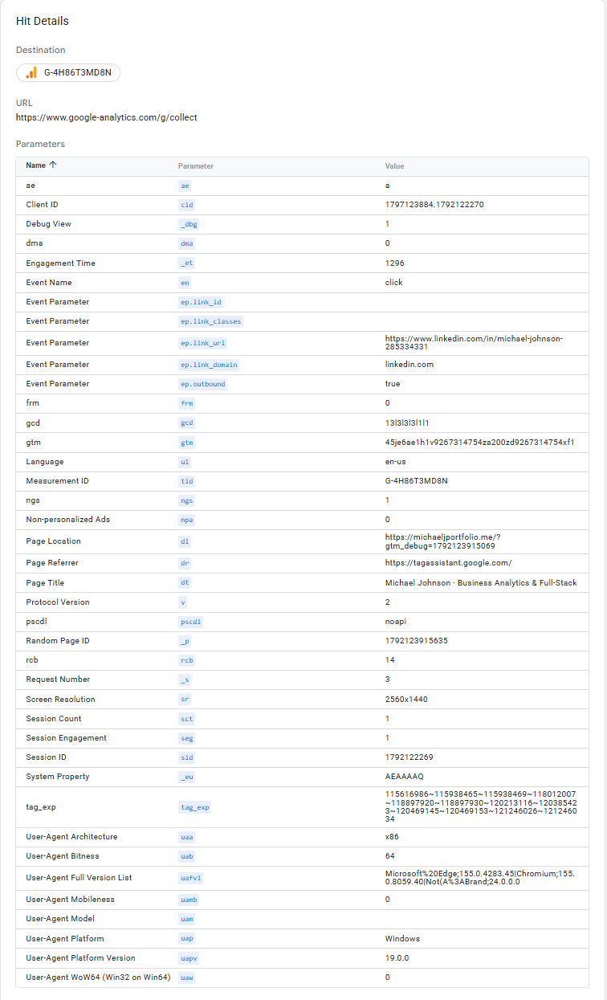

# Exercise 06: Measure the site with Google Analytics 4

Live site: **https://michaeljportfolio.me** · Privacy page: **https://michaeljportfolio.me/privacy**

## 1. What is installed

| | |
| --- | --- |
| Property | GA4, Jobs & Education, Small (1–10 employees) |
| Measurement ID | `G-4H86T3MD8N` |
| Stream | Web stream for `https://michaeljportfolio.me` |
| Enhanced measurement | On, including outbound clicks |
| Google signals | Off |
| Data retention | Events 2 months, user data 14 months |
| Where the tag lives | [`src/app/layout.tsx`](../../src/app/layout.tsx) — the root layout, which is the only layout, so the tag renders once in `<head>` on every route |
| Commits | `62ab9d2` (privacy page and footer link), `42cbc74` (the tag) |
| Deployment | Railway `2052a91a-f035-4497-87cd-39dd065bc3a1`, built commit `42cbc746c29b5ab5a2ed6167df70dea52ef03035`, `SUCCESS` |

The measurement ID is public by design; no secret was added to the page.

**One tag, not two.** Searching the live page source for `G-4H86T3MD8N` returns four hits on `/` and six
on `/privacy`, but only one is an executable tag. Next.js serializes the layout into its RSC payload
(`self.__next_f.push(...)`), which is page data rather than a second tag, and `/privacy` also prints the
ID in its visible text. Counting only `<script>` elements gives one loader and one inline config block
on both routes.

## 2. Privacy notice

GA4 sets cookies and sends visit data to Google, so the tag shipped alongside a plain-language
[Privacy page](https://michaeljportfolio.me/privacy) linked from the site footer. It states what is
collected and why, who receives it (Google LLC and Railway), and how to opt out.

Every claim on it was checked against the code: the site has no forms or API routes, the Copy email
button only writes to the clipboard, the database holds résumé content with no visitor table, and
`next/font` self-hosts the fonts so no request reaches Google Fonts.

It also says plainly what is **not** implemented: there is no cookie banner, analytics starts on page
load, and the site does not honour Do Not Track or Global Privacy Control. The EU/EEA/UK section states
that the site does not meet the opt-in standard there. A notice alone is not consent, and the page does
not pretend otherwise.

## 3. Events received

`page_view` 6, `scroll` 2, `click` 1, `first_visit` 1, `session_start` 1, `user_engagement` 1.

The outbound click, captured in Tag Assistant because Realtime shows parameter names without their
values:

| Parameter | Value |
| --- | --- |
| Event name (`en`) | `click` |
| `ep.link_url` | `https://www.linkedin.com/in/michael-johnson-285334331` |
| `ep.link_domain` | `linkedin.com` |
| `ep.outbound` | `true` |
| Measurement ID (`tid`) | `G-4H86T3MD8N` |
| Endpoint | `https://www.google-analytics.com/g/collect` |

The address matches the LinkedIn link in the site footer, and it contains no email address or access
code. The page location carries a `gtm_debug` parameter because the hit was captured in debug mode.

Google's **Test your website** check under View tag instructions → Install manually also passed.

## 4. What went wrong, and how it was fixed

**Zero events, while the tag tested successfully.**

- *What happened:* Realtime showed zeros everywhere after the deploy, but Google's own installation
  test reported success.
- *How we investigated:* We ruled the site out first. The live response carries no Content-Security-Policy
  and `Cache-Control: no-store`, so nothing server-side blocked or cached the script. Requesting
  `gtag/js?id=G-4H86T3MD8N` returned a 535 KB configured container, against 439 KB for a deliberately
  fake ID, proving the ID was real; that container included `__ccd_em_page_view` and
  `__ccd_em_outbound_click`, so the stream was set up for both events. Edge's console then showed
  `net::ERR_BLOCKED_BY_CLIENT` on the `gtag.js` request.
- *The cause:* Edge's tracking prevention blocked the request in my own browser. Google's test passed
  because Google fetched the page from its own servers, where nothing was blocking.
- *The fix:* an exception for `michaeljportfolio.me` under Settings → Privacy, search, and services →
  Tracking prevention.
- *What confirmed it:* `page_view` appeared in Realtime immediately afterwards.

**The click event did not appear at first.** The event is named `click`, not `outbound_click`, and the
footer links have no `target="_blank"`, so the page unloads the instant they are clicked. Ctrl-clicking
the LinkedIn link opens it in a background tab, which leaves the page loaded and lets the beacon send
cleanly.

## 5. What the click tells me, and what it does not

The event shows that someone on my site followed the footer link to my LinkedIn profile: the
destination, its domain, and that the link left the site. For a career site that is the closest thing
to an outcome — it suggests the page did its job and sent a reader on to my profile.

It does not establish *why* anyone clicked, whether they meant to, or what they did after arriving.
GA4 sees the click leave my site and nothing beyond it.

The counts are also a floor rather than a total. My own tag was invisible to GA4 until I added a
browser exception, and most visitors running tracking protection will never be measured at all. That is
the same limit the Privacy page describes from the visitor's side, and the site works normally either
way: when the tag was blocked, every page still rendered and nothing broke.
