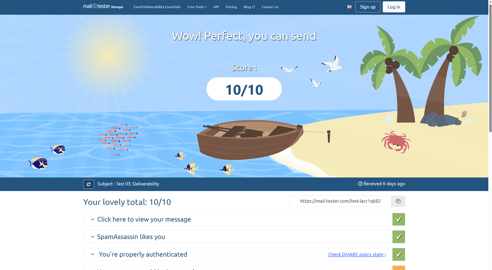

# Exercise 06: Domain email and Google Analytics

Live site: **https://michaeljportfolio.me** · Privacy page: **https://michaeljportfolio.me/privacy**

Domain `michaeljportfolio.me`, DNS at Cloudflare. Mailbox `michaelj@michaeljportfolio.me` on Zoho Mail's
free plan — no paid plan was needed. The outside mailbox used for every send and receive below is my LMU
student mailbox, which runs on Microsoft 365; its address is left out of this file on purpose.

## 1. Email tests

All three tests ran through the Zoho Mail MCP server from Claude Code. Times are Pacific.

| # | Test | Time | Result |
| --- | --- | --- | --- |
| 1 | **Received.** Message sent from the outside mailbox to `michaelj@michaeljportfolio.me`, subject `Test 01: inbound` | 2026-10-13, 2:54:30 PM PDT | **Pass.** Delivered to the Zoho Inbox, not Spam. Retrieved through the MCP server (`ZohoMail_listEmails`): From the LMU address, To `Michaelj@michaeljportfolio.me`. |
| 2 | **Replied.** Reply to `Test 01: inbound` from the domain address back to the outside mailbox, subject `Re: Test 01: inbound` | 2026-10-19, 8:09:07 PM PDT | **Pass.** `ZohoMail_sendEmail` returned HTTP 200 and Message-ID `<1a15748bea6.852fa538818015.5355390537921729259@michaeljportfolio.me>`. In Zoho's Sent folder with `mailDeliveryStatus: success`, From `michaelj@michaeljportfolio.me`. **Arrived in the outside mailbox's Inbox**, where Microsoft recorded `spf=pass`, `dkim=pass`, and `dmarc=pass` — the excerpt in item 2 is this message's header. |
| 3 | **Sent a new message.** New message, not a reply, from the domain address to the outside mailbox, subject `Test 02: Outbound` | 2026-10-13, 2:56:56 PM PDT | **Pass.** In Zoho's Sent folder with `mailDeliveryStatus: success`, From `michaelj@michaeljportfolio.me`. **Arrived in the outside mailbox's Inbox.** A second new message, `Test 04: outbound via Zoho MCP`, was sent the same way on 2026-10-15 at 2:34:58 PM PDT and also reported `success`. |

**Arrival in the outside mailbox.** Both the reply and the new message landed in the LMU mailbox's **Inbox**,
not Junk. Nothing had to be rescued from a spam folder in either direction.

**From address.** Every outgoing message in Zoho's Sent folder shows `fromAddress: michaelj@michaeljportfolio.me`,
not the `@zohomail.com` alias the account was created under. Outgoing mail carries the domain.

## 2. SPF, DKIM, and DMARC results

These are the **receiving mailbox's** results, taken from the message source of the row-2 reply as the LMU
mailbox (Microsoft 365) received it. Its `Message-Id` is the one Zoho assigned on send, so the header belongs
to that exact test message. Signature values, antispam tokens, and the recipient address are left out:

```
Authentication-Results: mx.microsoft.com 1;
 spf=pass (sender IP is 165.173.180.52) smtp.mailfrom=michaeljportfolio.me;
 dkim=pass (signature was verified) header.d=michaeljportfolio.me;
 dmarc=pass action=none header.from=michaeljportfolio.me;
 compauth=pass reason=100

ARC-Authentication-Results: i=2; mx.microsoft.com 1;
 spf=pass (sender ip is 165.173.180.52) smtp.mailfrom=michaeljportfolio.me;
 dmarc=pass (p=none sp=none pct=100) action=none header.from=michaeljportfolio.me;
 dkim=pass (signature was verified) header.d=michaeljportfolio.me; arc=pass

Received-SPF: Pass (protection.outlook.com: domain of michaeljportfolio.me
 designates 165.173.180.52 as permitted sender)
 receiver=protection.outlook.com; client-ip=165.173.180.52;
 helo=sender6-of-o52.zoho.com; pr=C

DKIM-Signature: v=1; a=rsa-sha256; c=relaxed/relaxed; s=zmail;
 d=michaeljportfolio.me; i=michaelj@michaeljportfolio.me   [b= value omitted]

X-Forefront-Antispam-Report: CIP:165.173.180.52; CTRY:US; SCL:-1;
 H:sender6-of-o52.zoho.com; PTR:sender6-of-o52.zoho.com; CAT:NONE; DIR:INB

From: michaelj@michaeljportfolio.me
Subject: Re: Test 01: inbound
Date: Mon, 19 Oct 2026 20:09:07 -0700
Message-Id: <1a15748bea6.852fa538818015.5355390537921729259@michaeljportfolio.me>
```

**SPF, DKIM, and DMARC all pass, and all three are aligned to `michaeljportfolio.me`** rather than to Zoho's
own domain: `smtp.mailfrom`, `header.d`, and `header.from` are the same domain. The DKIM selector in the
signature is `zmail`, matching the `zmail._domainkey` record published in DNS below, so Microsoft verified the
signature against my own key. `SCL:-1` is Microsoft's lowest spam confidence level, which is why the message
reached the Inbox rather than Junk. DMARC passed under the published `p=none` policy — monitoring only, so a
failure would not have been rejected; the pass is what shows the setup is correct, and `p=none` is what the
record says, not an assumption.

**Corroboration — an independent receiver.** `Test 03: Deliverability` was sent from the domain address on
2026-10-13 at 3:14:47 PM PDT to an external mail-tester.com mailbox, which scored it **10/10**: SPF `Pass`
(record `v=spf1 mx include:zoho.com ~all`), DKIM `Pass` — "Your DKIM signature is valid", `d=michaeljportfolio.me`,
selector `zmail`, rsa-sha256 with a 1024-bit key, valid for both the author domain and the envelope-from domain —
and DMARC `Pass`, "Your message passed the DMARC test". Its only note was `SPF_HELO_NONE` (0.0 points), meaning
Zoho's HELO hostname has no SPF record of its own, which does not affect the domain's result. That test left
Zoho from `165.173.180.54` rather than `.52`; both are Zoho outbound relays covered by the `include:zoho.com`
in the SPF record.



The mail-tester report expires about seven days after the send, so the screenshot is the lasting record of it.

**Corroboration — the receiving provider's own reports.** Microsoft now sends DMARC aggregate reports to the
domain, and two have arrived in the Zoho Inbox: `Report Domain: michaeljportfolio.me`,
`Submitter: enterprise.protection.outlook.com`, covering the UTC days 2026-10-14 and 2026-10-15. Microsoft runs
the LMU mailbox, so the `rua` address in the DMARC record is working and the receiving side is reporting back
on mail from the domain.

### The mail records that produce those results

Confirmed live in public DNS on 2026-10-19 by querying `8.8.8.8`:

| Name | Type | Value |
| --- | --- | --- |
| `@` | MX | `mx.zoho.com` (10), `mx2.zoho.com` (20), `mx3.zoho.com` (50) |
| `@` | TXT | `v=spf1 mx include:zoho.com ~all` |
| `@` | TXT | `zoho-verification=zb29670445.zmverify.zoho.com` — domain ownership, verified |
| `zmail._domainkey` | TXT | `v=DKIM1; k=rsa; p=MIGfMA0GCSqGSIb3DQEBAQUAA4GNADCBiQKBgQCaLjfst…` |
| `_dmarc` | TXT | `v=DMARC1; p=none; rua=mailto:` + the domain mailbox |

Only one SPF record exists, so there was nothing to merge or de-duplicate. Zoho's account state agrees with
DNS: `mxStatus: true` and `smtpStatus: true` for the mailbox.

**The website records were preserved.** The three hosting records recorded in
[`dns-before-zoho.md`](dns-before-zoho.md) are unchanged — the root `CNAME` to Railway is still **DNS only**,
the proxied `www` A record still backs the `www` → root redirect, and `_railway-verify` is intact. The root
`CNAME` and the new `MX` coexist at `@` because Cloudflare flattens the CNAME. Checked after the mail change:
`https://michaeljportfolio.me/` returns `200` and `https://michaeljportfolio.me/privacy` returns `200`.

## 3. Analytics: page_view, click, and the click's destination

Live site: **https://michaeljportfolio.me** · Privacy page: **https://michaeljportfolio.me/privacy**

GA4 measurement ID `G-4H86T3MD8N`, one web stream for `https://michaeljportfolio.me`, enhanced measurement on
including outbound clicks. The tag renders once in `<head>` from the root layout, which is the only layout, so
it loads once on every route. The measurement ID is public by design; no secret was added to the page. The
Privacy page is linked from the site footer and states what GA4 collects, who receives it, how to opt out, and
what is **not** implemented — there is no cookie banner, and the site does not honour Do Not Track or Global
Privacy Control.


`page_view` 6, `scroll` 2, `click` 1, `first_visit` 1, `session_start` 1, `user_engagement` 1.


The outbound click's destination details, captured in Tag Assistant because GA4 Realtime shows parameter names
without their values:

| Parameter | Value |
| --- | --- |
| Event name (`en`) | `click` |
| `ep.link_url` | `https://www.linkedin.com/in/michael-johnson-285334331` |
| `ep.link_domain` | `linkedin.com` |
| `ep.outbound` | `true` |
| Measurement ID (`tid`) | `G-4H86T3MD8N` |
| Endpoint | `https://www.google-analytics.com/g/collect` |

`link_url` matches the LinkedIn link in the site footer, `link_domain` is `linkedin.com`, and `outbound` is
`true`, so the link left the site. The address contains no email address or access code.

## Notes: what went wrong, and how it was fixed

**Zero GA4 events, while Google's own installation test passed.** Realtime showed zeros after the deploy. I
ruled the site out first: the live response carries no Content-Security-Policy and `Cache-Control: no-store`,
so nothing server-side blocked or cached the script, and requesting `gtag/js?id=G-4H86T3MD8N` returned a 535 KB
configured container against 439 KB for a deliberately fake ID — proving the ID was real and that the container
included `__ccd_em_page_view` and `__ccd_em_outbound_click`. The browser console then showed
`net::ERR_BLOCKED_BY_CLIENT` on the `gtag.js` request: **Edge's tracking prevention was blocking it in my own
browser.** Google's test passed because Google fetched the page from its own servers. Adding an exception for
`michaeljportfolio.me` fixed it, and `page_view` appeared in Realtime immediately.

**The click event did not appear at first.** The event is named `click`, not `outbound_click`, and the footer
links have no `target="_blank"`, so the page unloads the instant they are clicked. Ctrl-clicking the LinkedIn
link opens it in a background tab, which leaves the page loaded and lets the beacon send.

**What the click tells me, and what it does not.** It shows that a reader on my site followed the footer link
to my LinkedIn profile — the destination, its domain, and that the link left the site. For a career site that
is close to an outcome. It does not establish why anyone clicked, whether they meant to, or what they did after
arriving. The counts are a floor, not a total: my own tag was invisible until I added a browser exception, and
visitors running tracking protection are never measured. The site works either way — when the tag was blocked,
every page still rendered.
