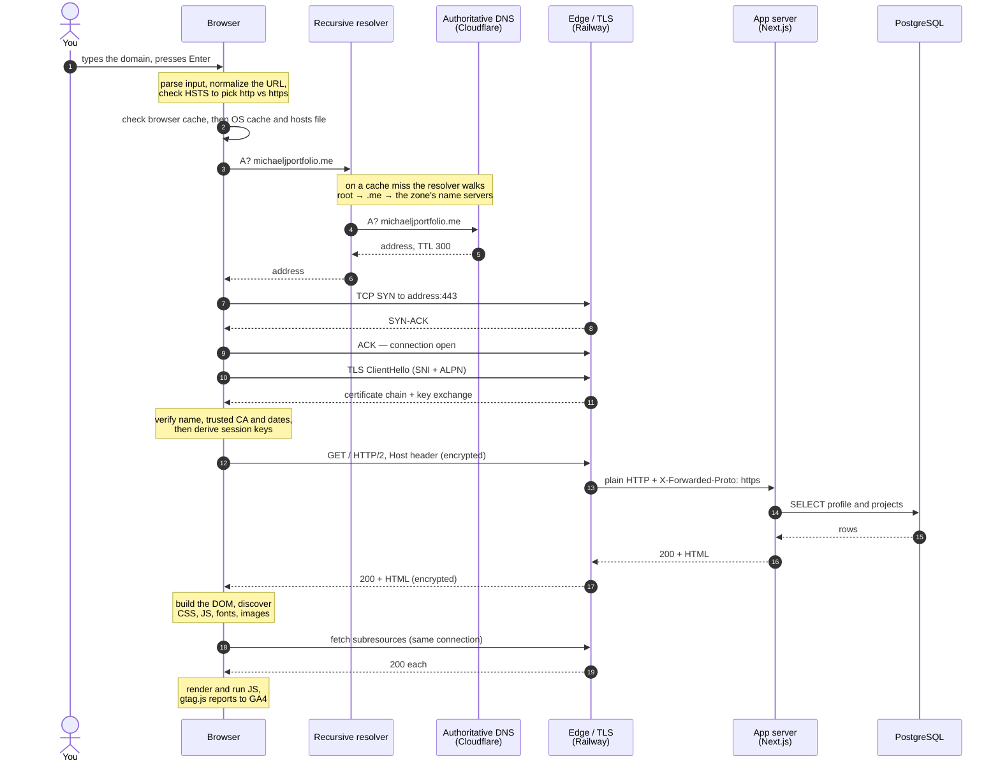
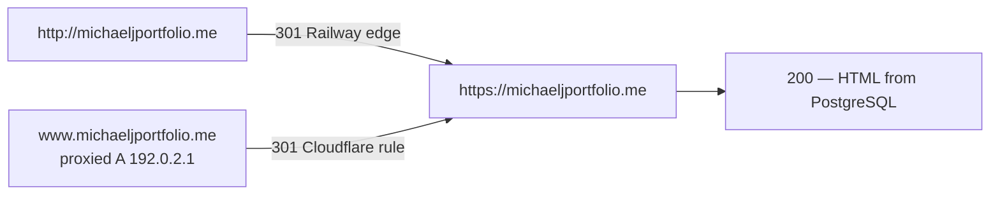
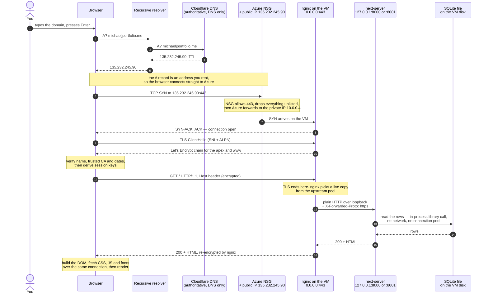

# Practice: what happens when you enter a domain and press Enter

Interview practice notes for `michaeljportfolio.me`, recorded 2026-10-20. The first two diagrams
describe the site as it runs on Railway today. The third is the same request path as it worked on
the Azure VM (September-October 2026), kept for the comparison.

## On Railway: the request and the response, end to end

DNS resolution, the TCP and TLS handshakes, the database read, and the render.

## When the first answer is a redirect

A 3xx does not render: the browser starts over at the `Location` header, and a different host needs
a fresh DNS lookup. This domain has two such hops.

The `www` hop never reaches a server. `192.0.2.1` is a reserved documentation address that exists
only to give Cloudflare's proxy a hostname to attach the redirect rule to, so Cloudflare answers the
301 itself.

## On the Azure VM: the same path, different owners

How the same request travelled when the site ran on `vm-career-platform` behind nginx, with SQLite
on the VM's disk.

### The walkthrough

**1. The browser resolves the name.** The same tree walk — cache, resolver, root, `.me`, Cloudflare —
but the answer differs in kind. Cloudflare held two **A** records, `@` and `www`, both pointing at
`135.232.245.90`, both **DNS only**. An A record is a literal address you rent from Azure, so the
browser connects to a machine you are responsible for. Today's apex is a CNAME to a Railway
hostname, which lets Railway change the underlying address without touching the zone.

**2. The address is not on the VM.** The public IP lives in Azure's network fabric, not on the
interface: `ip addr` on the VM only ever shows `10.0.0.4`. Azure receives traffic for
`135.232.245.90` and forwards it inward, so the VM answers on a private address.

**3. The NSG decides before the VM does.** Packets meet the network security group first:
`Allow-SSH-Laptop` (TCP 22 from one `/32`), `Allow-HTTP-80`, and the 443 rule added with TLS.
Anything not allowed is dropped by the default `DenyAllInBound`. That is why 8000 and 8001 were
unreachable from the internet while still listening — `curl` from the laptop returned `000`. On
Railway there is no equivalent control: the platform's edge is the only door.

**4. TCP, then TLS, terminated by nginx.** nginx listens on `0.0.0.0:443` and presents the Let's
Encrypt certificate covering both `michaeljportfolio.me` and `www`. Its master process runs as root
to bind the low port, then hands traffic to `www-data` workers. Renewal was mine: Certbot's timer
twice a day, renewing inside 30 days of the 90-day life. That whole job disappeared in the migration.

Because the certificate covered both names and both A records pointed at the same box, **`www`
needed no redirect** — nginx served it directly. Today `www` is a Cloudflare redirect rule, because
Railway's plan allows one custom domain. Port 80 stayed open so nginx could redirect it to HTTPS and
so Let's Encrypt's HTTP-01 challenge could prove domain control.

**5. nginx chooses an upstream.** `proxy_pass` to a pool of two, `127.0.0.1:8000` and
`127.0.0.1:8001`, each `max_fails=1 fail_timeout=5s`, with
`proxy_next_upstream error timeout http_502 http_503`. A dead copy is retried silently on the other.
nginx also sets `Host`, `X-Forwarded-For`, and `X-Forwarded-Proto $scheme` — the same header
Railway's edge sets today, and how Next.js knows the original request was HTTPS.

**6. The hop to the app crosses nothing.** Loopback only (`-H 127.0.0.1` in the systemd unit).
Plaintext is acceptable here because the bytes never leave the machine.

**7. The database read is not a network call.** SQLite is a library: the app opens a file on the
VM's disk and reads pages in-process. No handshake, no pool, no credentials, nothing to time out.
Today the same step is TCP + TLS to a separate Postgres service, which is why `src/db/client.ts`
needs pool options, a connection timeout, and an error listener so a dropped idle connection cannot
crash the server.

**8. Back out the way it came.** The app returns HTML to nginx, nginx encrypts it into the TLS
session and writes it back through the NSG. The browser-side GA4 hop would look identical, since
`gtag.js` reports straight to Google and never touches the server — though the tag was added
2026-10-15, after the move, so it never ran on the VM.

### What breaks differently

- **Kill one app copy** — the visitor sees nothing. All 12 requests returned 200 while systemd
  restarted it (`Restart=always`, back in about 2 s).
- **Kill both** — nginx returns 502 for about 4 s, and keeps returning it for roughly 2 s after the
  copies are back, because `fail_timeout=5s` must expire first (`no live upstreams` in the log).
- **Reboot the VM** — everything returns on its own in about 9 s, because the units are enabled into
  `multi-user.target`.
- **The VM deallocates** — a total outage with nothing to fail over to, which the 6 PM auto-shutdown
  caused mid-exercise.

### Side by side

| | Azure VM | Railway |
|---|---|---|
| DNS record | A → an IP you rent | CNAME → a platform hostname |
| Firewall | Your NSG rules | The platform's, not yours |
| TLS ends at | Your nginx, your Certbot | Railway's edge |
| Renewal | Your timer, your problem | Theirs |
| App processes | Two systemd copies you supervise | Containers Railway supervises |
| Database hop | A file read, in-process | TCP + TLS to another service |
| A bad release | Restart and hope | Health-checked before traffic switches |

Sources: [operating the VM](docs/superpowers/plans/2026-10-01-operate-the-vm.md),
[Ex04 HTTPS write-up](docs/how-this-site-is-secured.md),
[Exercise 03](docs/evidence/ex03.md).
