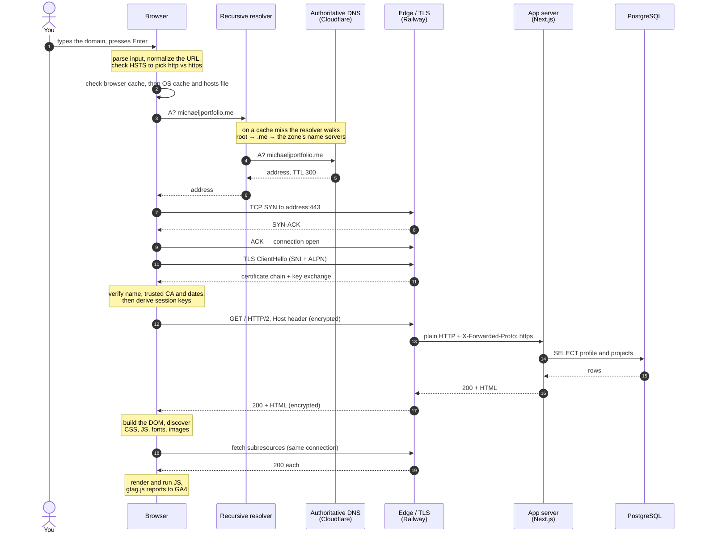
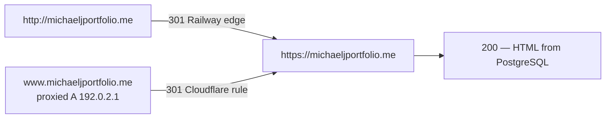

# Practice: what happens when you enter a domain and press Enter

Interview practice notes for `michaeljportfolio.me`. Both diagrams describe the site as it runs
on Railway, recorded 2026-10-20.

## The request and the response, end to end

DNS resolution, the TCP and TLS handshakes, the database read, and the render.

## When the first answer is a redirect

A 3xx does not render: the browser starts over at the `Location` header, and a different host needs
a fresh DNS lookup. This domain has two such hops.

The `www` hop never reaches a server. `192.0.2.1` is a reserved documentation address that exists
only to give Cloudflare's proxy a hostname to attach the redirect rule to, so Cloudflare answers the
301 itself.
