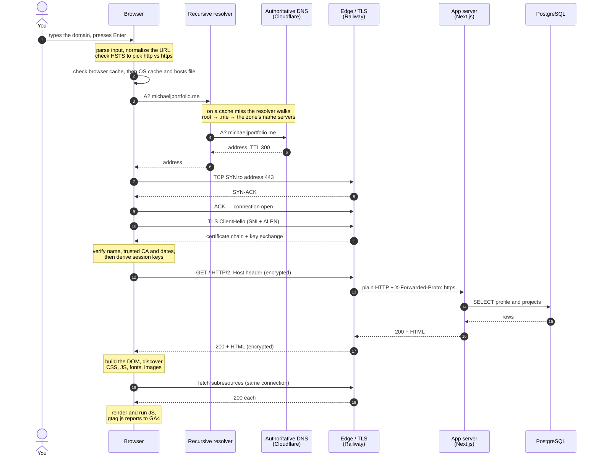
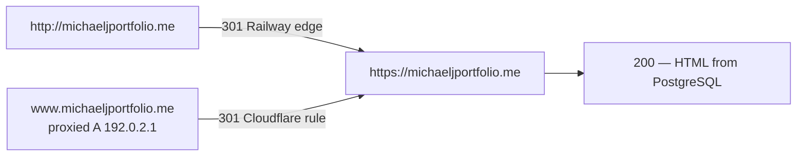
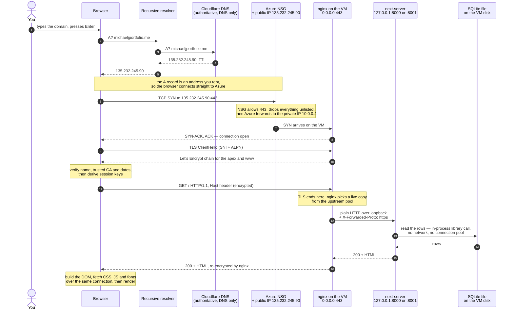

# Practice: what happens when you enter a domain and press Enter

Interview practice notes for `michaeljportfolio.me`, recorded 2026-10-20. The first two diagrams
describe the site as it runs on Railway today. The third is the same request path as it worked on
the Azure VM (September-October 2026), kept for the comparison.

## On Railway: the request and the response, end to end

DNS resolution, the TCP and TLS handshakes, the database read, and the render.

## When the first answer is a redirect

A 3xx does not render: the browser starts over at the `Location` header, and a different host needs
a fresh DNS lookup. This domain has two such hops.

The `www` hop never reaches a server. `192.0.2.1` is a reserved documentation address that exists
only to give Cloudflare's proxy a hostname to attach the redirect rule to, so Cloudflare answers the
301 itself.

## On the Azure VM: the same path, different owners

How the same request travelled when the site ran on `vm-career-platform` behind nginx, with SQLite
on the VM's disk.

### The walkthrough

The whole trip: the browser, a DNS resolver, Cloudflare, Azure's front door, the firewall, nginx on
the VM, one of two app copies, a file on the disk, and all the way back.

**1. You press Enter. The browser is stuck.** It has a *name*, `michaeljportfolio.me`, and names are
not addresses. Nothing can be sent to a name, so nothing happens until it gets a number.

**2. It asks a resolver for the address.** The browser asks the DNS resolver its network gave it.
That resolver asks around until it reaches Cloudflare, because Cloudflare is the authority for the
name — that is what pointing the domain at Cloudflare's nameservers means. Cloudflare answers
`135.232.245.90`.

**3. The browser opens a connection to that address, on port 443.** Port 443 is where HTTPS lives by
convention. Now it has somewhere to send the request.

**4. The request arrives at Azure, not at the VM.** That address belongs to Azure's network, not to
the machine. The VM only knows itself as `10.0.0.4`. Azure catches traffic for the public address
and forwards it inward.

**5. Azure's firewall decides whether to let it through.** Before the VM sees anything, the network
security group checks its rules: SSH from my laptop only, port 80, port 443. Anything else is
dropped silently. This request is on 443, so it passes and Azure forwards it to `10.0.0.4`.

**6. nginx answers, because nothing else can.** The app listens on `127.0.0.1:8000` and `:8001`, and
`127.0.0.1` means "only from inside this machine." Traffic from the internet cannot reach it. nginx
is the only program listening on an address the outside world can reach, so every visitor goes
through nginx. That is the point of it.

**7. The browser and nginx set up encryption.** nginx sends the Let's Encrypt certificate. The
browser checks three things: does the name on it match, was it issued by a CA I trust, is it still
in date. If yes, the two agree on keys and everything after this is encrypted. The certificate and
its private key live on the VM, which is why nginx does this step and not the app.

**8. Now the actual request goes over: `GET /`.** It is encrypted in transit, and nginx decrypts it
on arrival, because nginx holds the keys.

**9. nginx passes it to one of the two app copies.** It picks `127.0.0.1:8000` or `:8001`. Two
copies exist so that if one dies the other still answers and nobody notices. This hop is plain
HTTP, which is fine: it never leaves the machine, so there is no wire to listen on.

**10. The app needs the content, so it opens a file.** SQLite is not a server to connect to. It is a
file on the VM's disk, and the app reads it directly, the way a program opens any file. No
connection, no password, no network. The app reads the profile and projects out of it and builds the
HTML.

**11. The HTML goes back to nginx.** Back to whoever asked. nginx made the request, so nginx gets
the answer.

**12. nginx encrypts it and sends it to the browser.** Out through Azure and back across the
internet. It has to be encrypted because the browser's secure session is with nginx — that is who it
shook hands with in step 7.

**13. The browser reads the page and asks for the rest.** The HTML mentions CSS, fonts, JavaScript
and images. For each one the browser repeats steps 8 to 12, but not steps 2 to 7, because it already
knows the address and already has an open encrypted connection. Then it draws the page.

**The idea worth holding onto.** Every step is a handoff, and at each handoff something can refuse.
DNS can hand back the wrong address. The firewall can drop the packet. The certificate can fail the
check. nginx can find no app copy alive and answer 502. The app can fail to read its file. When the
site is broken the real question is *which handoff failed*, and each one has its own test — which is
why `dig` can settle a DNS question without ever touching TLS.

### What breaks differently

- **Kill one app copy** — the visitor sees nothing. All 12 requests returned 200 while systemd
  restarted it (`Restart=always`, back in about 2 s).
- **Kill both** — nginx returns 502 for about 4 s, and keeps returning it for roughly 2 s after the
  copies are back, because `fail_timeout=5s` must expire first (`no live upstreams` in the log).
- **Reboot the VM** — everything returns on its own in about 9 s, because the units are enabled into
  `multi-user.target`.
- **The VM deallocates** — a total outage with nothing to fail over to, which the 6 PM auto-shutdown
  caused mid-exercise.

### Side by side

| | Azure VM | Railway |
|---|---|---|
| DNS record | A → an IP you rent | CNAME → a platform hostname |
| Firewall | Your NSG rules | The platform's, not yours |
| TLS ends at | Your nginx, your Certbot | Railway's edge |
| Renewal | Your timer, your problem | Theirs |
| App processes | Two systemd copies you supervise | Containers Railway supervises |
| Database hop | A file read, in-process | TCP + TLS to another service |
| A bad release | Restart and hope | Health-checked before traffic switches |

Sources: [operating the VM](docs/superpowers/plans/2026-10-01-operate-the-vm.md),
[Ex04 HTTPS write-up](docs/how-this-site-is-secured.md),
[Exercise 03](docs/evidence/ex03.md).
